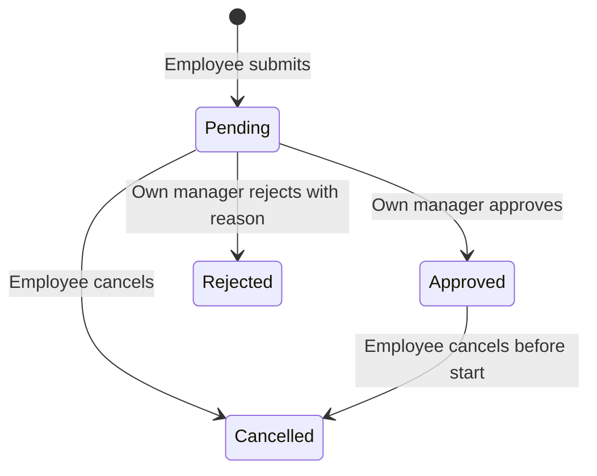

# People HRIS acceptance target

People is a functional leave-management application at `/hris`, backed by the same Docker PostgreSQL instance as the other independent target websites. It has real authentication, server-enforced role checks, durable requests, balances, and an append-only business audit history. It sends no emails or payroll instructions.

Start `/lab` → **Employee → manager → HR** for a fresh isolated company. All tabs in that browser share the lab run, so sign out and sign in as the next actor to perform the complete journey. A fresh scenario starts a new company; it does not reset the normal company or another browser's lab run. Do not start another preset in the middle of a multi-role journey.

## Public sample accounts

All sample accounts use `Leave123!`. These credentials are synthetic and only belong to the sample company. They are also displayed directly on the [HRIS sign-in page](https://demoweb.madacoda.dev/hris/login), with a link to the isolated sign-in test.

| Email              | Role             | Scope                                             |
| ------------------ | ---------------- | ------------------------------------------------- |
| alex@people.test   | Employee         | Alex's own requests and balances, Product team    |
| sam@people.test    | Employee         | Sam's own requests and balances, Product team     |
| nina@people.test   | Employee         | Nina's own requests and balances, Operations team |
| maya@people.test   | Manager          | Alex and Sam, Product team                        |
| leo@people.test    | Manager          | Nina, Operations team                             |
| harper@people.test | HR administrator | All employee requests, balances, and activity     |

Passwords are salted scrypt hashes in PostgreSQL. Session tokens are random, stored hashed, rotated on login/logout, and expire after 30 minutes. Five failed logins cause a 15-minute lockout. A logged-out or expired session cannot retrieve private data or submit a mutation.

For positive and negative authentication checks, start `/lab` → **HRIS sign-in: correct and incorrect password**. Enter a wrong password of at least eight characters for Alex, confirm the error, then use `Leave123!` to sign in. Sign out and try Maya and Harper for the manager and HR views. Each start creates a separate company, so a lockout does not affect the shared normal sample.

## Permission matrix

| Operation                            | Employee | Manager             | HR                                    |
| ------------------------------------ | -------- | ------------------- | ------------------------------------- |
| View requests, balances and audit    | Own only | Direct reports only | All employees                         |
| Submit leave                         | Own only | Denied              | Denied                                |
| Cancel future Pending/Approved leave | Own only | Denied              | Denied                                |
| Approve/reject Pending request       | Denied   | Direct reports only | Denied                                |
| Adjust allowance                     | Denied   | Denied              | Allowed with reason and version check |

Roles come exclusively from the authenticated server session. Forged `role` or `employeeId` fields do not grant privileges. Inaccessible record IDs return 404; disallowed operations return 403. The website also shows an access-restricted state for direct navigation to a forbidden page.

## Complete acceptance journey

1. Sign in as Alex. Annual leave starts with 12 days of allowance, one Pending day, and 11 available days.
2. Request one day on an unused weekday, with a reason of at least 10 characters. The request becomes Pending, reserved days become 2, and available days become 10.
3. Sign out. Sign in as Maya, open Approvals, find the new request and approve it.
4. Sign out. Sign in as Harper and open Leave balances. Alex now has 1 Approved day, 1 Pending day, and 10 available days. Activity identifies the employee's submission and Maya's decision separately.
5. Sign in as Alex, open the approved request and cancel it. Available days become 11. Retrying cancellation with the same request ID does not release another day.

Rejection requires a note of 10–1,000 characters. It releases the reserved days and preserves the explanation for the employee. A new request may reuse rejected or cancelled dates.

Rejected and Cancelled requests have no further transitions. Approved requests cannot be approved or rejected again. Edits to existing requests require the current integer version; stale attempts return 409. Successful retries of the same request ID return the original result. Reusing that ID for a different payload returns 409.

## Policy rules to assert

- Annual allowance starts at 12 days; Sick starts at 10.
- Available = allowance − Pending days − Approved days. Pending requests reserve balance.
- Monday–Friday are working days. Friday–Monday counts as two days; weekend-only requests are rejected.
- Half-day requests must cover exactly one working day and consume 0.5 days. This sample does not distinguish morning from afternoon: overlapping half days on the same date are rejected.
- Start/end are real ISO dates using the company's UTC calendar. Dates must be from today through 365 days ahead, with at most 30 calendar days in one request.
- Pending and Approved leave cannot overlap, even across Annual/Sick types. Client-supplied day totals and identities are ignored.
- HR may set an allowance from 0–60 days in half-day increments. It cannot be less than Approved plus Pending days, and every adjustment requires a reason.
- Every successful submit, decision, cancellation or allowance adjustment creates one audit event. A failed or replayed operation creates none.
- A PostgreSQL row lock serializes mutations for the company. Concurrent submissions cannot overdraw a balance; concurrent decisions cannot both win.

These are explicit sample policies, not employment-law rules. Holidays, regional calendars, yearly accrual/carryover, payroll, notifications, attachments, delegation and SSO are outside this target's implemented scope.

## Edge-case presets

The lab provides nine HRIS presets: sign-in, complete journey, rejection, permissions, exhausted balance, competing decisions, filters/pagination, a committed request with interrupted response, and session expiry during submission. The downloaded catalog contains 20 HRIS-specific acceptance plans, plus cross-site authentication, HTTP, validation, filtering and recovery cases.

`/hris/api` accepts JSON POST actions `bootstrap`, `login`, `logout`, `submit`, `decide`, `cancel`, and `adjust-balance`. Business mutations require a 16–80 character alphanumeric/hyphen `requestId`. Decisions, cancellations and balance adjustments require the current `version`. API bodies are limited to 16 KiB and cross-site browser requests are rejected.

For concurrent-role browser automation, start a lab run in one context and explicitly copy only its HttpOnly `district_lab` cookie to the other test contexts before logging in separately. That deliberately shares a synthetic company while keeping each role's `lab_people_session` independent. The raw lab token is not included in reports or exports.
